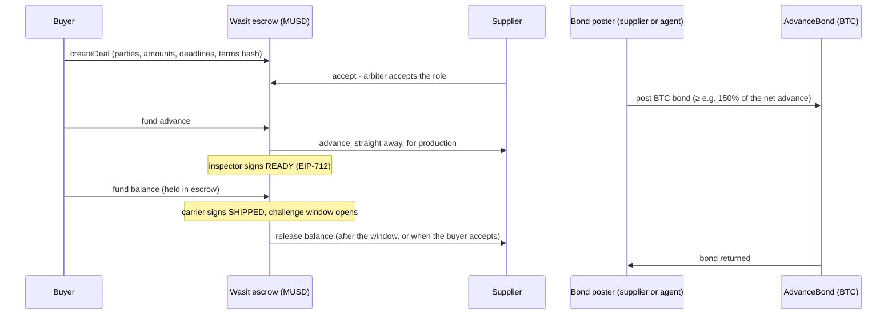

# Wasit

**Protecting advance payments in stablecoin trade, on Mezo.**

A buyer pays a supplier's production advance in MUSD. The supplier, or their sourcing agent, can
back that advance with a **BTC bond**. The balance waits in MUSD escrow and is released only on
**signed statements from named parties**, after a challenge window. Disputes go to a named arbiter.

BTC-secured, with limits: Mezo testnet only, not audited. See [Limits](#limits).

## The problem

Importers already pay foreign suppliers in stablecoins, because bank wires are slow and dollars
are scarce. Usual sourcing terms are a 30% production deposit and a 70% balance before shipping.
The deposit leaves before any goods exist, and a stablecoin transfer cannot be undone. The usual
fallbacks are a bank letter of credit, which is slow, costly and often refused to small firms, or
a marketplace's own payment protection, which only works on that marketplace.

Wasit does not lend money. It fixes the terms, the people and the deadlines before any money moves,
and then enforces them.

## How it works



| If… | Then |
|---|---|
| The supplier misses the ready or ship deadline | Anyone can close the deal: the escrow refunds what it holds and the bond pays back the advance, as far as its value allows |
| The buyer does not fund the balance in time | The supplier keeps the advance; the bond goes back |
| The buyer disputes within the challenge window | The arbiter splits the balance and decides how much of the advance the bond pays back |
| The arbiter does not rule in time | Anyone can release the balance to the supplier (the terms say so up front) |
| BTC falls | Below 130% coverage the bond poster is told to top up; below 115% anyone can convert the bond's BTC to MUSD |

A signed statement means a named party, chosen by both sides at creation, signed it with a
fingerprint (hash) of their evidence. It proves the evidence file was not changed afterwards. It
does not prove that goods exist or shipped; that is why the challenge window and the arbiter exist.

## Real vs simulated

| | Live deployment | demo-sim deployment |
|---|---|---|
| BTC price | Skip BTC/USD aggregator on Mezo | `DemoOracle`, price set by hand |
| Swaps (protect, claim) | Mezo Router and pool | Mezo Router and pool (real) |
| Tokens | Testnet MUSD and BTC | Testnet MUSD and BTC |
| Label in the app | none | "Simulated price feed" banner on every page and on each bond |

The simulated feed exists only to show a price crash on demand. The app shows the banner when the
deployment is labeled demo-sim **or** the bond's oracle answers `isSimulated() = true`.

## Mezo integrations

| Piece | How Wasit uses it |
|---|---|
| **MUSD** | Settlement currency: advance, balance, refunds and fees. Funding uses an EIP-2612 permit read from MUSD's EIP-5267 domain, or approve + pay |
| **BTC (ERC-20 precompile)** | Bond collateral, posted and returned as native BTC on Mezo |
| **Skip BTC/USD** | Live price for coverage, protection and claims, with staleness and bounds checks |
| **Pyth** | Alternative adapter, implemented and fork-tested; not deployed while its testnet feed is stale |
| **Mezo Router** | Sells bond BTC for MUSD on protect or claim, with an oracle-bounded minimum output |
| **Mezo Passport** | Wallet connection for both Bitcoin and EVM wallets |

## Security model

- The owner configures **new** deals and bonds only (fee recipient, fee up to a hard cap of 1%,
  allowed tokens, oracle and swap adapter for new bonds, pausing new deals). It can never move deal
  funds or bond collateral, change an existing deal, or pause an exit. No upgradeable proxies.
- Refunds of escrowed MUSD never depend on the bond or its oracle; a failed bond call is recorded
  and anyone can retry it.
- The bond never sells BTC without a fresh, non-zero oracle price, and every sale has an
  oracle-bounded minimum output.
- Fees are only taken on value that stays with the supplier: no fee on refunds or on the bond.
- Escrowed MUSD is never deposited anywhere (no vaults, no yield).
- Not audited. Internal reviews, test strategy and accepted risks:
  [docs/security-review.md](docs/security-review.md).

## Limits

- **The bond can fall short.** In a fast BTC crash the bond can be worth less than the advance
  before anyone protects it. The buyer then receives what the bond holds, not more. The deal page
  shows the coverage ratio and the top-up and protection lines at all times.
- MUSD is valued at 1 USD; there is no depeg guard yet.
- Attestations are only as good as the people named to sign them.
- Testnet only, not audited, Wave 1 of a buildathon.

## Deployed on Mezo testnet (chain 31611)

| Contract | Live | demo-sim |
|---|---|---|
| WasitEscrow | [`0x9d7573dd…9fC85`](https://explorer.test.mezo.org/address/0x9d7573dd4A929311DDFC130ED085127517A9fC85) | [`0xFa1B4Edf…03A23`](https://explorer.test.mezo.org/address/0xFa1B4EdffAEc7B152c9a72eEe526D887db503A23) |
| AdvanceBond | [`0x195474AF…f5Ad0`](https://explorer.test.mezo.org/address/0x195474AF5d673e1597Eb31E978a57F81892f5Ad0) | [`0xBE4bA4F1…7330A`](https://explorer.test.mezo.org/address/0xBE4bA4F159cC37D82EaF65445acD5c58f847330A) |
| Price oracle | [Skip adapter `0xf672c00d…299A`](https://explorer.test.mezo.org/address/0xf672c00d3b4937110E50fc97496c82c0Ea12299A) | [DemoOracle `0x4B076a87…7EB1`](https://explorer.test.mezo.org/address/0x4B076a87367F47CfBe41E7D339D256933A617EB1) |
| Swap adapter | [`0x9B9Ae691…3Ea84`](https://explorer.test.mezo.org/address/0x9B9Ae691ce29Ef9D8be38f5Ff2ffD77FE143Ea84) | [`0x72143A06…A8163`](https://explorer.test.mezo.org/address/0x72143A060E09585079FE2E20958574b697EA8163) |

All verified on the explorer. The full list, with seeded demo deals and their transactions, is in
[`deployments/`](deployments/). Open the app with `?deployment=mezo-testnet-demo-sim` to use the
demo-sim set.

## Run locally

Requirements: Node 20+, pnpm (version pinned in `package.json`; `corepack enable` picks it up),
[Foundry](https://getfoundry.sh).

```sh
pnpm install
pnpm --filter @wasit/web dev          # web app on http://localhost:5173

cd contracts
forge build && forge test             # unit, fuzz and invariant tests
MEZO_TESTNET_RPC=https://rpc.test.mezo.org FOUNDRY_PROFILE=fork forge test   # fork tests
```

The web app reads Mezo testnet directly; no backend. `VITE_WALLETCONNECT_PROJECT_ID` enables
WalletConnect wallets (optional).

## Layout

| Path | Contents |
|---|---|
| `contracts/` | Foundry project: `WasitEscrow`, `AdvanceBond`, oracle and swap adapters, tests |
| `apps/web/` | Vite + React app: create a deal, deal page, attestor signing, arbiter console |
| `packages/sdk/` | ABIs, deployed addresses and EIP-712 helpers generated from the contracts |
| `packages/scripts/` | Testnet seed scripts for the demo deals |
| `deployments/` | Deployed addresses per network |
| `docs/` | Security review, demo checklist |

## Roadmap

- Pilot with sourcing agents on a real trade corridor (legal check first).
- Arabic and French interface.
- An indexer instead of reading events from the browser.
- MUSD depeg guard using a MUSD/USD feed.
- Optional BTC payout for suppliers.

## License

[MIT](LICENSE)
