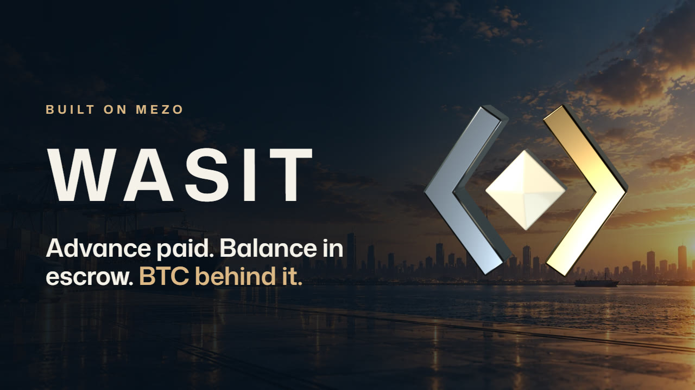
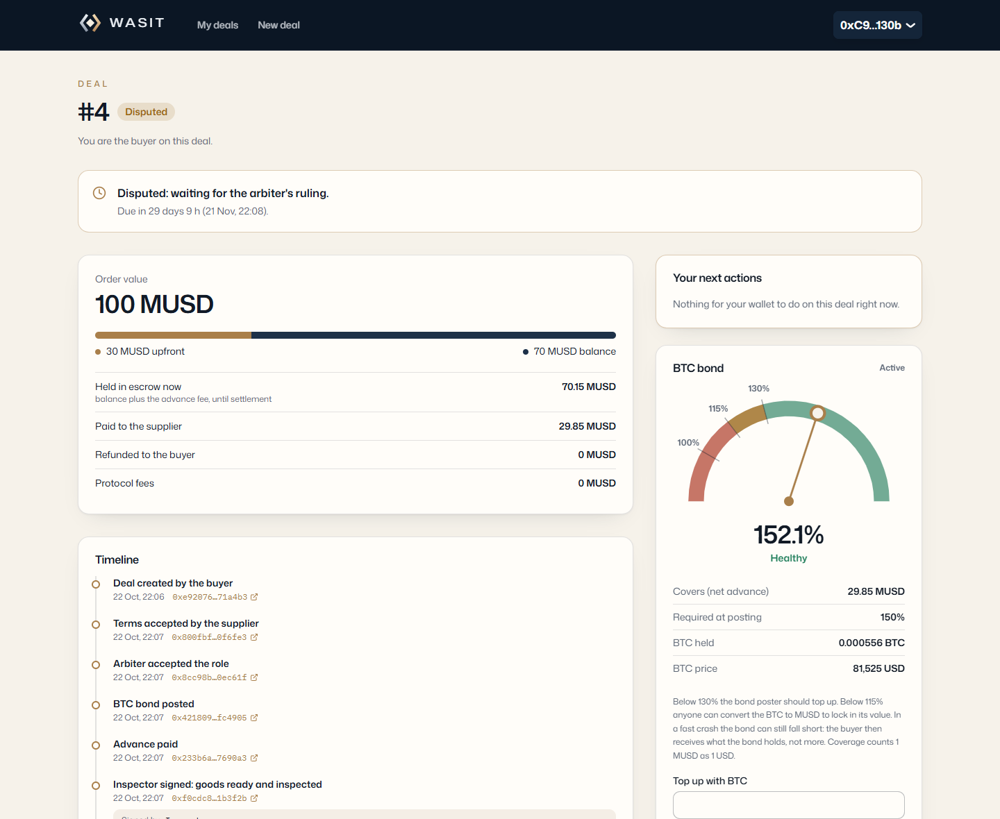
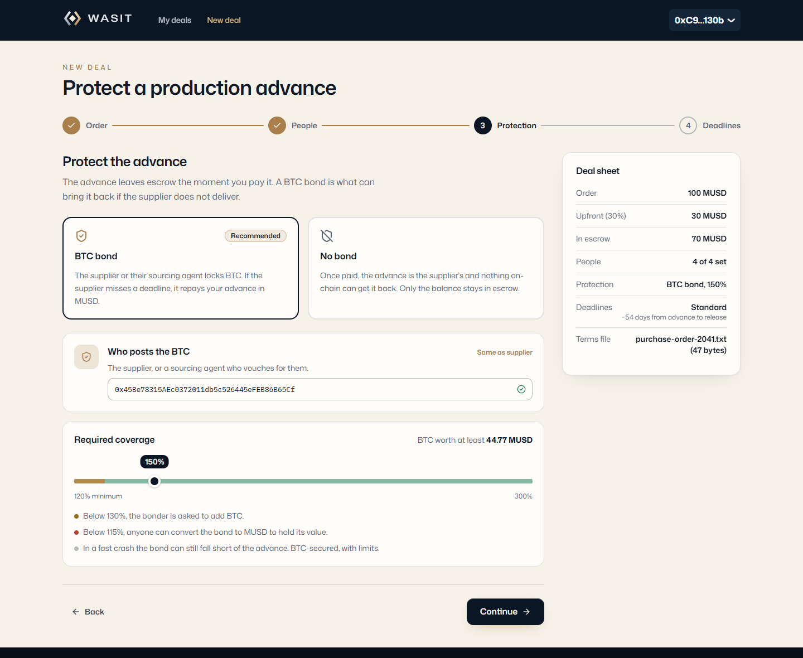
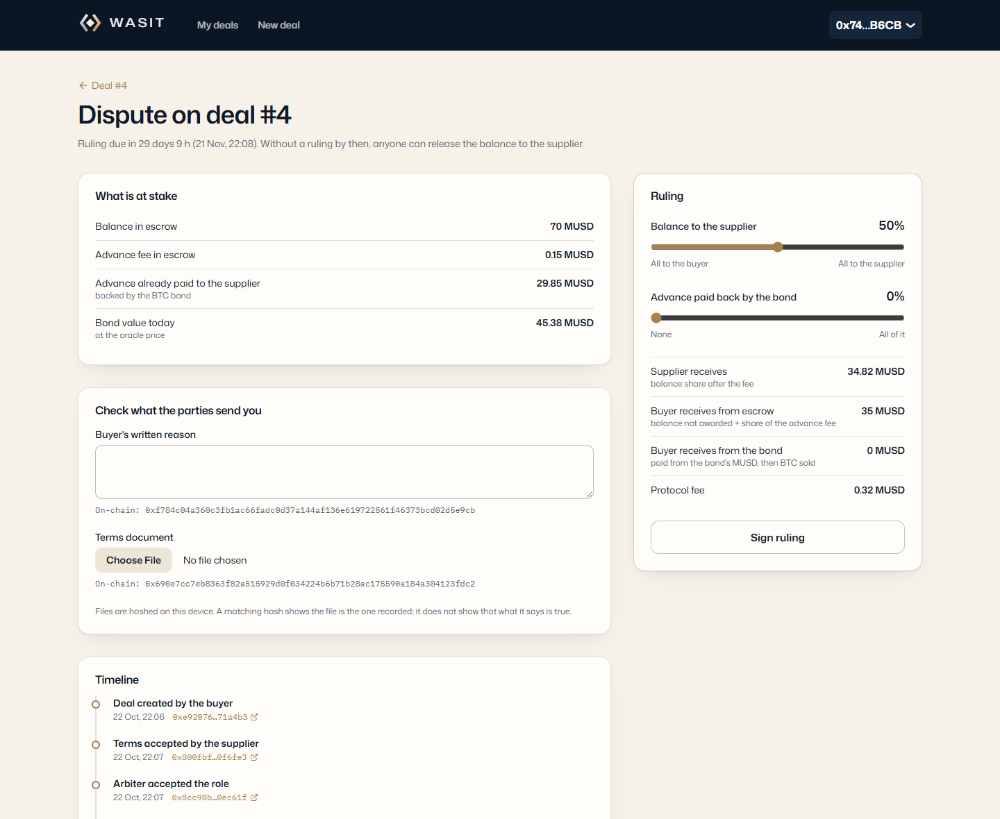
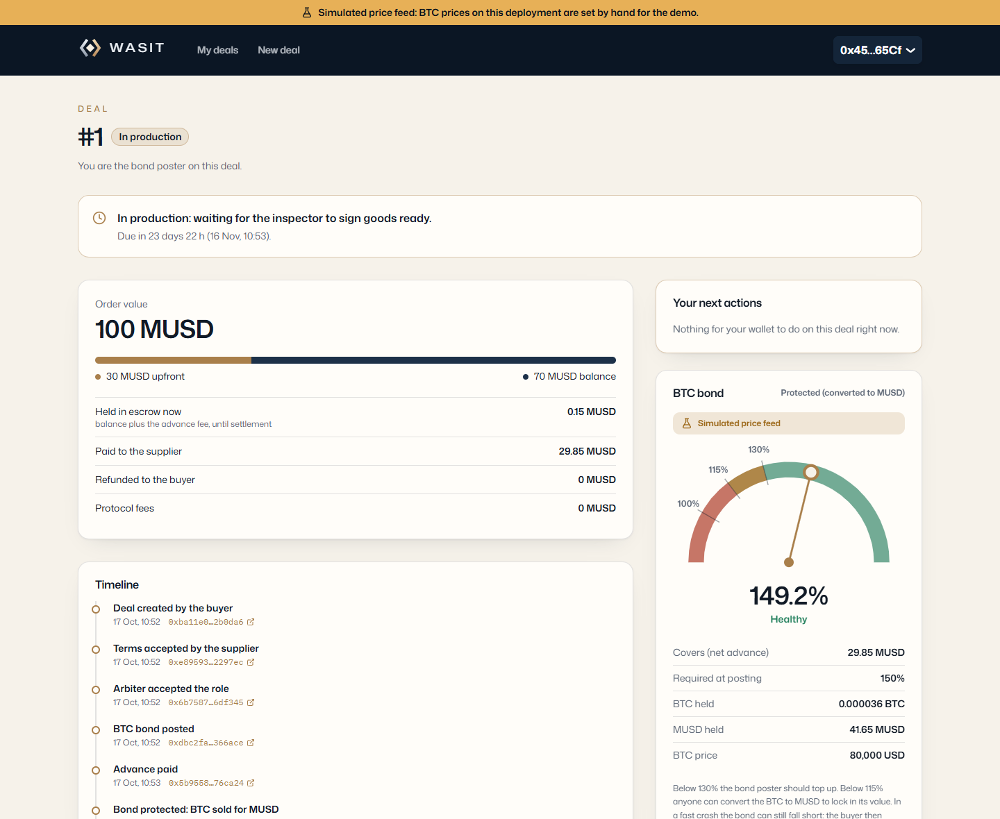
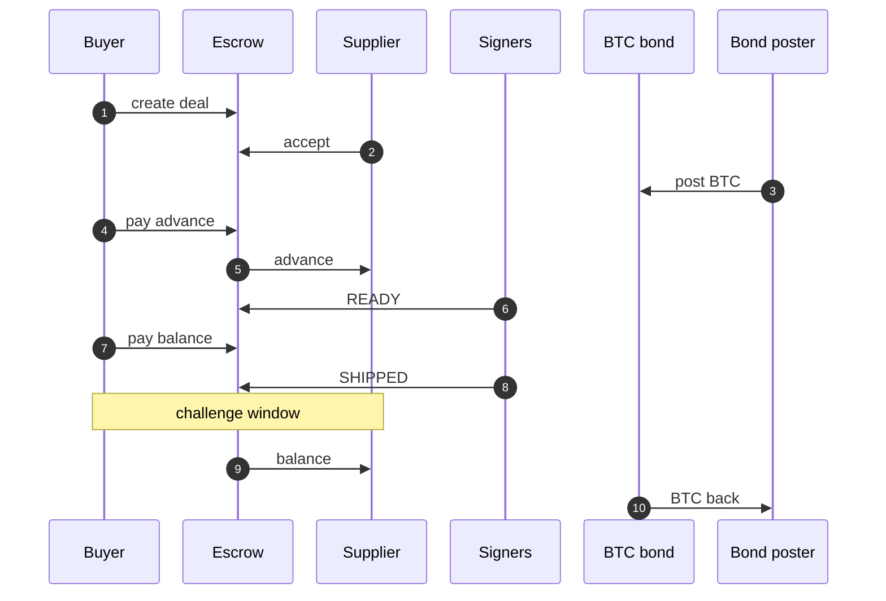
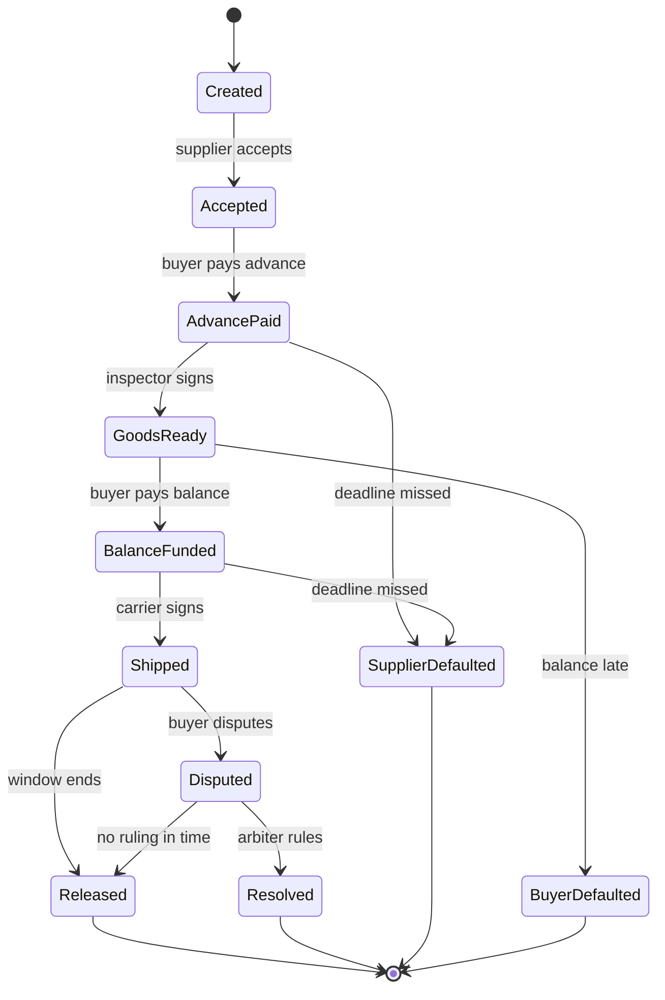

<div align="center">


# Wasit

**Advance paid. Balance in escrow. BTC behind it.**

[](https://explorer.test.mezo.org/address/0x9d7573dd4A929311DDFC130ED085127517A9fC85)
[](https://github.com/farouk-allani/wasit/actions/workflows/ci.yml)
[](contracts/)
[](#tests)
[](#tests)
[](#tests)
[](docs/security-review.md)
[](LICENSE)

**[Live app: wasit.app](https://wasit.app)** ·
**[Demo video](https://youtu.be/FLnJNJjdF8I)** ·
**[Live proof](#live-proof)** ·
**[A full deal on the explorer](https://explorer.test.mezo.org/tx/0x12a1b91615d829ebbcbe8cf411f2385860d59d511077be02ebdc95e270e7c788)** ·
**[Security review](docs/security-review.md)** ·
**[Contracts](#deployed-on-mezo-testnet)**

</div>

Wasit protects the riskiest payment in cross-border trade: the **production advance**. A buyer pays
a supplier's deposit in **MUSD** on Mezo. The supplier, or the sourcing agent who vouches for them,
backs that advance with a **BTC bond**. The balance waits in escrow and is released only on
**signed statements from named parties** (an inspector, a carrier), after a challenge window.
Disputes go to an arbiter both sides named up front.

BTC-secured, with limits: Mezo testnet, not audited. See [Limits](#limits).

[](https://youtu.be/FLnJNJjdF8I)

*Watch the demo (2:41): what Wasit is for, then a real 100 MUSD deal run through the app on Mezo
testnet, from creation to release, and what happens when things go wrong.*

## The problem

Importers already pay foreign suppliers in stablecoins, because bank wires are slow and dollars are
scarce. Common sourcing terms are **30% upfront for production, 70% before shipping**. The deposit
leaves before any goods exist, and a stablecoin transfer cannot be pulled back. The usual cover is
a bank letter of credit, which is slow and costly, and is often refused to small firms (41% of SME
trade finance requests are rejected, ADB Global Trade Finance Gap Survey, 2026). The other option
is a marketplace's own payment protection, which only works inside that marketplace.

## How Wasit fixes it

Wasit does not lend money. It fixes the terms, the people and the deadlines before any money moves,
then enforces them on-chain. Everyone involved is a wallet address named in the deal:

| Party | Role | What protects the others |
|---|---|---|
| **Buyer** | Creates the deal, pays the advance and later the balance | Cannot pull the advance back; can dispute only within the challenge window |
| **Supplier** | Accepts the terms; gets the advance at once, the balance on release | Misses a deadline: anyone can close the deal and the bond repays the advance |
| **Bond poster** | The supplier or their sourcing agent; locks BTC worth a multiple of the advance set in the deal (150% in our demos) | Gets the BTC back when the deal settles; pays the buyer back if the supplier defaults |
| **Inspector** | Signs *goods ready and inspected* (EIP-712), with a fingerprint of the report | Only the named inspector's signature counts, once, for this step |
| **Carrier** | Signs *goods shipped*, with a fingerprint of the bill of lading | Same rule; shipping opens the challenge window |
| **Arbiter** | Rules on a dispute: splits the balance, decides what the bond repays | Must accept the role before the advance is paid; a ruling not given in time releases to the supplier |

<table>
<tr>
<td width="50%"><br /><sub><b>Deal page.</b> Next step, money held and paid, live bond coverage, every event linked to the explorer.</sub></td>
<td width="50%"><br /><sub><b>Create a deal.</b> Four short steps. The protection step shows what the bond must hold and what happens below each line.</sub></td>
</tr>
<tr>
<td width="50%"><br /><sub><b>Arbiter console.</b> Checks the buyer's reason and the terms file against their on-chain hashes, then previews who receives what.</sub></td>
<td width="50%"><br /><sub><b>Bond protected</b> after a simulated price drop. The demo deployment is labeled on every page.</sub></td>
</tr>
</table>

## How it works



1. The buyer creates the deal: parties, amounts, deadlines and the hash of the terms document.
2. The supplier accepts, and so does the arbiter (not drawn).
3. The bond poster locks BTC worth the agreed share of the advance, e.g. 150%.
4. The buyer pays the advance with one EIP-2612 permit signature and one transaction, and
5. the escrow forwards it to the supplier at once, for production.
6. The inspector signs READY (EIP-712, with the report's fingerprint). Anyone can submit the
   signature, so the inspector needs no gas.
7. The buyer pays the balance, which the escrow holds.
8. The carrier signs SHIPPED, which opens the challenge window.
9. When the window ends without a dispute, or the buyer accepts early, the balance goes to the supplier,
10. and the bond returns the BTC to its poster.

Every deal moves forward through these states, and never back:



Before the advance, the buyer or the supplier can cancel. After it, the supplier can still return
the advance and cancel (from AdvancePaid, GoodsReady or BalanceFunded).

| If… | Then |
|---|---|
| The supplier misses the ready or ship deadline | Anyone can close the deal: the escrow refunds what it holds, and the bond sells BTC to repay the advance, as far as its value allows |
| The supplier cannot deliver | The supplier returns the advance; the escrow refunds the rest and the bond goes back |
| The buyer does not pay the balance in time | The supplier keeps the advance; the bond goes back |
| The buyer disputes within the challenge window | The arbiter splits the balance and decides how much of the advance the bond repays |
| The arbiter does not rule in time | Anyone can release the balance to the supplier (the terms say so up front) |
| BTC falls below 130% coverage | The bond poster is asked to top up |
| BTC falls below 115% coverage | Anyone can convert the bond's BTC to MUSD, so its value stops falling with BTC |

A signed statement proves that a named party signed it, together with a fingerprint (hash) of
their evidence file, so the file cannot be swapped later. It does not prove that goods exist or
shipped; the challenge window and the arbiter exist for that.

## Live proof

Everything below happened on Mezo testnet. Every link opens the transaction on the public explorer.

**A full deal, driven through the web app's own pages** (deal #5, 2026-10-23). Six wallets, one per
role, each in its own browser profile, clicking the real pages; each step checked on-chain before
the next. Created to released in about three minutes:
[create](https://explorer.test.mezo.org/tx/0xd3bba8a24a1bb97273afdb995a49affa3e100c9b92180adf1b0dd9f26f879304) ·
[supplier accepts](https://explorer.test.mezo.org/tx/0x72999ef15e72a2ce9f38865bad61558c3e805270dda3101a032c0ce50c70b9fd) ·
[arbiter accepts](https://explorer.test.mezo.org/tx/0xbb0a8896a5a5af57d6419262c105655e64609c1649aadd3dcc59333e5a3da243) ·
[BTC approve](https://explorer.test.mezo.org/tx/0x2405fc1f9523886e139502648786a00d90ed88544d3f5ef332fafdae610c63ec) ·
[bond posted](https://explorer.test.mezo.org/tx/0x56563c4932d91b226ea59e48220b4ae26299b3ca1db7642a61bc3b5b878044d9) ·
[advance with permit](https://explorer.test.mezo.org/tx/0xc2f61a17625205c39ebc17e47e198abb2fce6df3c1b0c72f730574958b2542ce) ·
[READY](https://explorer.test.mezo.org/tx/0xdb42bad47dfe066e560ddf13f787cc1d84515178b387aff5a60748c2b19458ae) ·
[balance with permit](https://explorer.test.mezo.org/tx/0xa107673ed4472c537161a7fb645ddcb31ed304fbe78faee2355c2e7028efaa24) ·
[SHIPPED](https://explorer.test.mezo.org/tx/0x55bdc61a7413ae9fce63a5dc8be5a0ecd3fa54004cdc7456d3b1e6c006e0a7ea) ·
[release](https://explorer.test.mezo.org/tx/0x12a1b91615d829ebbcbe8cf411f2385860d59d511077be02ebdc95e270e7c788).
The supplier received exactly 9.95 MUSD of the 10 MUSD order (0.5% fee), and the BTC went back to
the bond poster.

**The other outcomes**, each on a 100 MUSD order (30 upfront, 70 balance):

| Scenario | Deal | What happened on-chain | Key transactions |
|---|---|---|---|
| Happy path | live #2 | Released: 99.5 MUSD to the supplier, 0.5 MUSD fee; bond returned | [create](https://explorer.test.mezo.org/tx/0x4a1dcd2d4f0e10116e1399f86699b467fd352580cf85fccb720f77c5f62c2867) · [release](https://explorer.test.mezo.org/tx/0x679af6271dcfc0bc445b5dabd7009c07ae0d8fb453df65501f6123aba4807141) |
| Supplier default | live #3 | Production deadline missed. The escrow returned 0.15 MUSD; the bond sold BTC on the Mezo pool and paid 29.85 MUSD. **The buyer got the full 30 MUSD back** | [bond posted](https://explorer.test.mezo.org/tx/0x212220b3709b408216563f5d341ecd3520393293720c157f53f4e1e766530833) · [claim](https://explorer.test.mezo.org/tx/0x7d517a0cbaf2bc2325271173a52a1029d30389f37d413a0a0f3ab73be151c61b) |
| BTC crash (simulated price feed) | demo-sim #1 | Price set from 80,000 to 60,000; coverage fell to 113.6%, below the 115% line. Protection sold 0.000529 BTC for 41.66 MUSD on the **real** pool | [price drop](https://explorer.test.mezo.org/tx/0x4fca6c2c8e8fc1de7375ca38919e134abdd3d03782a1591ec40fb9548bc1bf32) · [protect](https://explorer.test.mezo.org/tx/0x89c823823e7ff466ace7210f99d42b77abfb80d870f2730211817949fe5ce7d1) |
| Dispute | live #4 | Buyer disputed after shipping; 70 MUSD held until the arbiter rules (due 21 Nov 2026) | [dispute](https://explorer.test.mezo.org/tx/0xbbcfb6372ceed7850494795b4c1ccabad0527cfba6942efc29bd326c2fa4d69e) |

## What the contracts refuse

The escrow and the bond re-check everything on every call. A call reverts unless all of this holds:

| # | Rule |
|---|---|
| 1 | Buyer and supplier differ, the arbiter is neither, and every party is a real address |
| 2 | The terms carry a document hash, amounts above zero, deadlines between 1 minute and 365 days, and the current fee (capped at 1% in code) |
| 3 | The advance is paid only after the supplier and the arbiter accepted, and the bond holds the required coverage |
| 4 | A statement counts only if the **named** inspector or carrier signed it (EOA or ERC-1271 smart account), for the current step, before its deadline, with an `issuedAt` between the previous step and now, and the deal's current nonce, so it cannot be replayed |
| 5 | A default can be claimed only after its deadline; an action only until it. No moment allows both |
| 6 | Only the buyer can dispute, and only within the challenge window; only the named arbiter can rule, and only within the arbitration period |
| 7 | The bond sells BTC only with a fresh, non-zero oracle price, and only for at least an oracle-bounded minimum output |
| 8 | The owner can configure **new** deals (fee recipient, fee, tokens, oracle and swap adapters) and pause **new** deals. It can never move deal funds or bond collateral, change a deal, or pause an exit. No upgradeable proxies |

Refunds of escrowed MUSD never depend on the bond or its oracle: the escrow pays first, and a bond
call that fails is recorded so anyone can retry it. Fees are taken only on value that stays with
the supplier: no fee on refunds, none on the bond. Escrowed MUSD is never deposited anywhere.

## Why Mezo

- **BTC is the collateral, natively.** BTC is Mezo's native asset and also an ERC-20 (a
  precompile), so the bond holds BTC itself, not a wrapped copy, and a sourcing agent posts it
  from the BTC they already keep on Mezo.
- **MUSD settles the trade.** A dollar stablecoin on the same chain as the collateral. It supports
  EIP-2612 permits (its EIP-5267 domain is read on-chain), so paying is one signature and one
  transaction.
- **On-chain price and liquidity.** The Skip BTC/USD feed prices coverage, and the Mezo Router turns
  bond BTC into MUSD when a deal needs it, against the real MUSD/BTC pool.
- **Mezo Passport** puts Bitcoin wallets (Unisat, OKX, Xverse) and EVM wallets in one connect dialog.

| Piece | How Wasit uses it |
|---|---|
| **MUSD** | Advance, balance, refunds and fees; funding with an EIP-2612 permit, or approve and pay |
| **BTC (ERC-20 precompile)** | Bond collateral, posted and returned as BTC on Mezo |
| **Skip BTC/USD** | Live price for coverage, protection and claims, with staleness and bounds checks |
| **Pyth** | Second oracle adapter, implemented and fork-tested; not deployed while its testnet feed is stale |
| **Mezo Router** | Sells bond BTC for MUSD on protection or a claim, with an oracle-bounded minimum output |
| **Mezo Passport** | Wallet connection in the web app |

## Tests

```sh
cd contracts
forge test                          # 263 tests: unit, fuzz and invariant
FOUNDRY_PROFILE=ci forge test       # same, with 10,000 fuzz runs and deeper invariant runs
forge coverage --report summary --no-match-coverage "(test|script)/"
MEZO_TESTNET_RPC=https://rpc.test.mezo.org FOUNDRY_PROFILE=fork forge test   # against Mezo testnet

cd .. && pnpm --filter @wasit/web test    # 77 web tests
```

- **Coverage:** 100% of lines (534/534), statements, branches (138/138) and functions in `src/`.
- **Fuzzing** (10,000 runs each in CI): fee and payment splits, arbiter rulings, bond claims, the
  coverage formula, protection prices, statements signed with the wrong key, oracle decimals.
- **Invariants** (random call sequences, 256 runs × depth 128 in CI, with moving BTC prices, pool
  slippage and oracle outages): every token the escrow or the bond holds is accounted for, to the
  wei; terminal deals hold nothing; open deals hold exactly what their state implies; states never
  go backwards; terms never change; closed bonds are empty; claims never pay more than the advance.
- **Fork tests** run the oracle adapters, the Router swap and the deployment script against
  Mezo testnet itself.
- **Web:** the deal view is rebuilt from events by a pure, unit-tested reducer; the payout preview
  mirrors the contract's split, checked by a conservation test.

## Limits

- **The bond can fall short.** In a fast BTC crash the bond can lose value faster than anyone
  converts it. The buyer then receives what the bond holds, not more. The deal page shows the
  coverage ratio and both lines at all times.
- MUSD is counted as 1 USD; there is no depeg guard yet.
- Signed statements are only as good as the people named to sign them.
- Event history is read straight from the public RPC, so a deal's timeline takes a few seconds to
  load. An indexer is on the roadmap.
- Mezo testnet only, not audited: two internal reviews, recorded in
  [docs/security-review.md](docs/security-review.md).

## Deployed on Mezo testnet

Chain 31611. All contracts are verified on the explorer. The web app is live at
**[wasit.app](https://wasit.app)** (static build on Vercel; it reads Mezo testnet directly).

| Contract | Live | demo-sim (simulated price feed) |
|---|---|---|
| WasitEscrow | [`0x9d7573dd…9fC85`](https://explorer.test.mezo.org/address/0x9d7573dd4A929311DDFC130ED085127517A9fC85) | [`0xFa1B4Edf…03A23`](https://explorer.test.mezo.org/address/0xFa1B4EdffAEc7B152c9a72eEe526D887db503A23) |
| AdvanceBond | [`0x195474AF…f5Ad0`](https://explorer.test.mezo.org/address/0x195474AF5d673e1597Eb31E978a57F81892f5Ad0) | [`0xBE4bA4F1…7330A`](https://explorer.test.mezo.org/address/0xBE4bA4F159cC37D82EaF65445acD5c58f847330A) |
| Price oracle | [Skip adapter `0xf672c00d…299A`](https://explorer.test.mezo.org/address/0xf672c00d3b4937110E50fc97496c82c0Ea12299A) | [DemoOracle `0x4B076a87…7EB1`](https://explorer.test.mezo.org/address/0x4B076a87367F47CfBe41E7D339D256933A617EB1) |
| Swap adapter | [`0x9B9Ae691…3Ea84`](https://explorer.test.mezo.org/address/0x9B9Ae691ce29Ef9D8be38f5Ff2ffD77FE143Ea84) | [`0x72143A06…A8163`](https://explorer.test.mezo.org/address/0x72143A060E09585079FE2E20958574b697EA8163) |

The demo-sim set exists only to show a price crash on demand. Its oracle reports
`isSimulated() = true`, and the app then shows a "Simulated price feed" banner on every page and on
each bond. Full addresses are in [`deployments/`](deployments/). Open the app with
`?deployment=mezo-testnet-demo-sim` to use that set.

## Run locally

Requirements: Node 20+, pnpm (`corepack enable` picks up the pinned version),
[Foundry](https://getfoundry.sh).

```sh
pnpm install
pnpm --filter @wasit/web dev        # web app on http://localhost:5173, reads Mezo testnet directly
```

No backend. `VITE_WALLETCONNECT_PROJECT_ID` enables WalletConnect wallets (optional; browser
wallets work without it).

| Path | Contents |
|---|---|
| [`contracts/`](contracts/) | Foundry project: `WasitEscrow`, `AdvanceBond`, oracle and swap adapters, tests |
| [`apps/web/`](apps/web/) | Vite + React app: create a deal, deal page, attestor signing, arbiter console |
| [`packages/sdk/`](packages/sdk/) | ABIs, addresses and EIP-712 helpers generated from the contracts |
| [`packages/scripts/`](packages/scripts/) | Testnet scripts that seeded the demo deals |
| [`deployments/`](deployments/) | Deployed addresses per network |
| [`docs/`](docs/) | Security review, demo checklist, deck outline |

## Roadmap

- A pilot with sourcing agents on one real trade corridor, after a legal check.
- Arabic and French interface.
- An indexer instead of reading events from the browser.
- A MUSD depeg guard using a MUSD/USD feed.
- Optional BTC payout for suppliers.
- A mainnet pilot with per-deal and total caps, only after an external review.

## License

[MIT](LICENSE)
